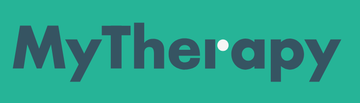
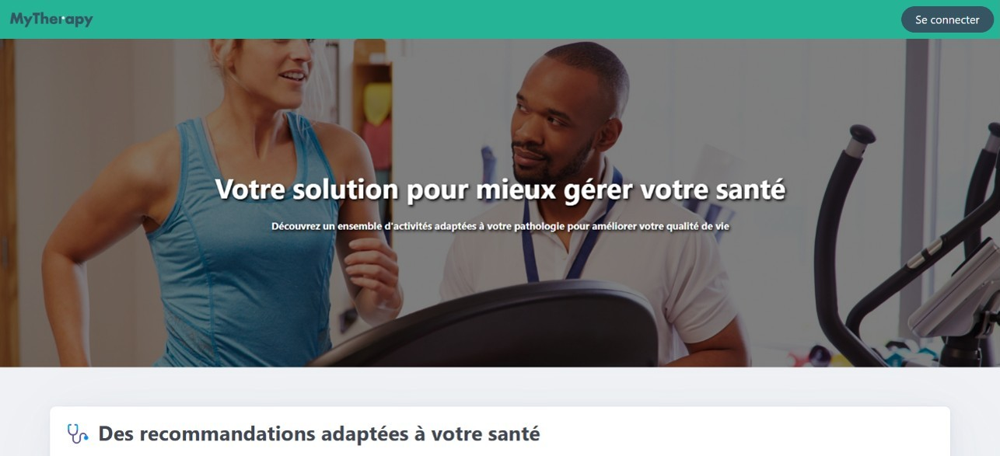

# MyTherapy
MyTherapy est une application web (projet JEE) qui aide les personnes atteintes d'une pathologie chronique à trouver des activités physiques adaptées près de chez elles, à les organiser en programmes et à suivre leur progression.
 


---
## Architecture
 
```
src/main/java/com/projet/mytherapy
├── controllers/    # Reçoivent les requêtes web et renvoient les pages Thymeleaf
├── models/         # Entités JPA, qui représentent les tables de la base
├── repositories/   # Accès à la base de données (Spring Data JPA)
├── services/       # Logique métier, appelée par les controllers
└── MyTherapyApplication.java
 
src/main/resources
├── static/         # CSS et images
├── templates/      # Pages Thymeleaf (+ fragments)
└── application.properties
```

## Technologies
 
- **Java 17+**
- **Spring Boot 3** (Spring MVC, Spring Data JPA, Spring Security)
- **Thymeleaf** pour les vues
- **MySQL** pour la base de données
- **Maven**
- **HTML / CSS**

---
 
## Fonctionnalités
 
- **Inscription / connexion** : le profil inclut la pathologie de l'utilisateur (métabolique, cardiovasculaire, cancer, respiratoire ou aucune).
- **Activités recommandées** : liste adaptée à la pathologie, avec recherche par nom et fiche détaillée.
- **Programmes** : création de programmes, ajout d'activités, notes et suivi de la progression.
- **Mon compte** : modification du profil, changement de mot de passe, suppression du compte.
- **Espace admin** : onglet "Gestion" réservé au rôle `ADMIN`, destiné à ajouter, modifier et supprimer les pathologies, activités, disciplines, etc. *(amélioration prévue, pas encore implémentée)*

---
 
## Installation
 
### 1. Prérequis
 
- JDK 17 ou plus récent
- Maven (ou le wrapper `mvnw` fourni)
- Un serveur MySQL (par exemple via XAMPP avec phpMyAdmin)

### 2. Cloner le projet
 
```bash
git clone https://github.com/Klemang/MyTherapy.git
cd MyTherapy
```
 
### 3. Préparer la base de données

Le fichier [`docs/base.sql`](docs/base.sql) crée les tables de l'application. Il ne contient pas de données.

**Avec phpMyAdmin (XAMPP)**
1. Démarrez MySQL et Apache.
2. Créez une base nommée `mytherapy` (interclassement `utf8mb4`).
3. Ouvrez-la, allez dans l'onglet **Importer** et sélectionnez `docs/base.sql`.

**En ligne de commande**
```bash
mysql -u root -p -e "CREATE DATABASE mytherapy CHARACTER SET utf8mb4;"
mysql -u root -p mytherapy < docs/base.sql
```

### 4. Ajouter des données

La base est vide au départ. Ajoutez vos propres données (pathologies, disciplines, activités et leurs liaisons) via phpMyAdmin ou des requêtes SQL, sinon aucune activité ne sera recommandée.

### 5. Configurer l'application
 
Dans `src/main/resources/application.properties`, adaptez la connexion à votre base :
 
```properties
spring.datasource.url=jdbc:mysql://localhost:3306/mytherapy
spring.datasource.username=root
spring.datasource.password=
```
 
> Adaptez `username` et `password` à votre installation MySQL. Avec XAMPP, l'utilisateur `root` n'a par défaut pas de mot de passe.
 
### 6. Lancer l'application
 
```bash
./mvnw spring-boot:run
```
(ou directement depuis votre IDE en exécutant la classe `MyTherapyApplication`)
 
L'application est ensuite disponible sur : **http://localhost:8080**
 
---

 
<p align="center">
  Développé par <a href="https://github.com/Klemang">Klemang</a>
</p>
